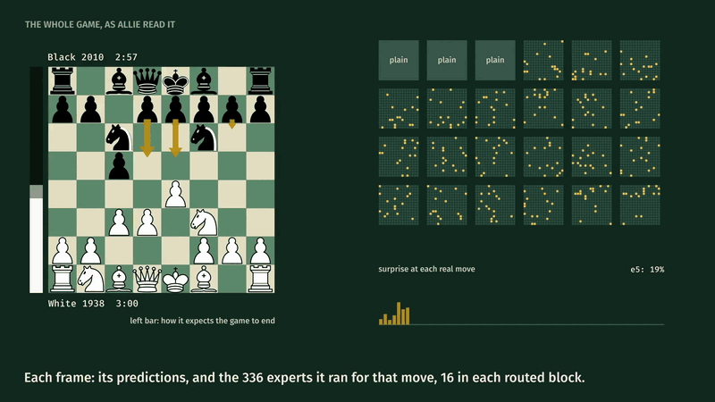
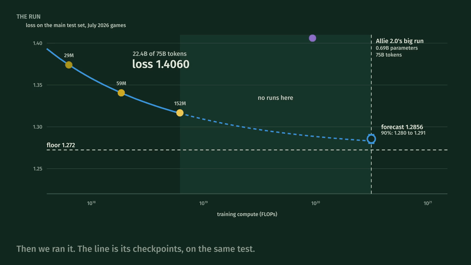
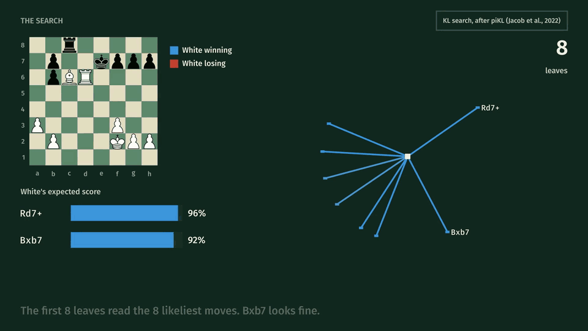
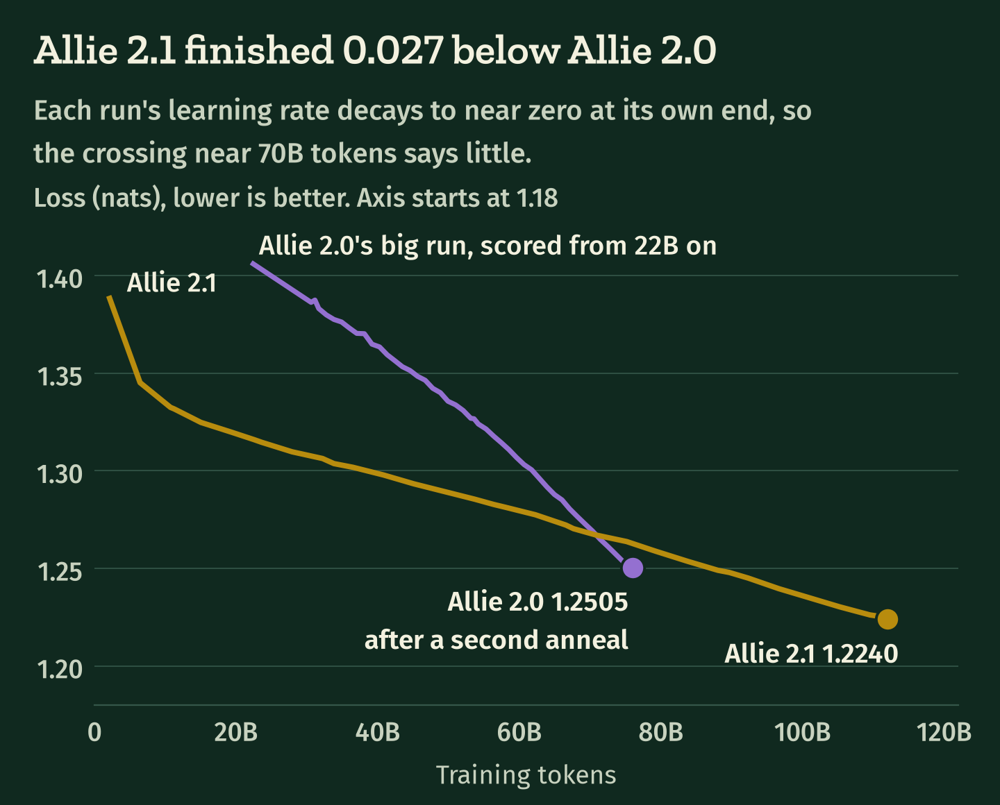
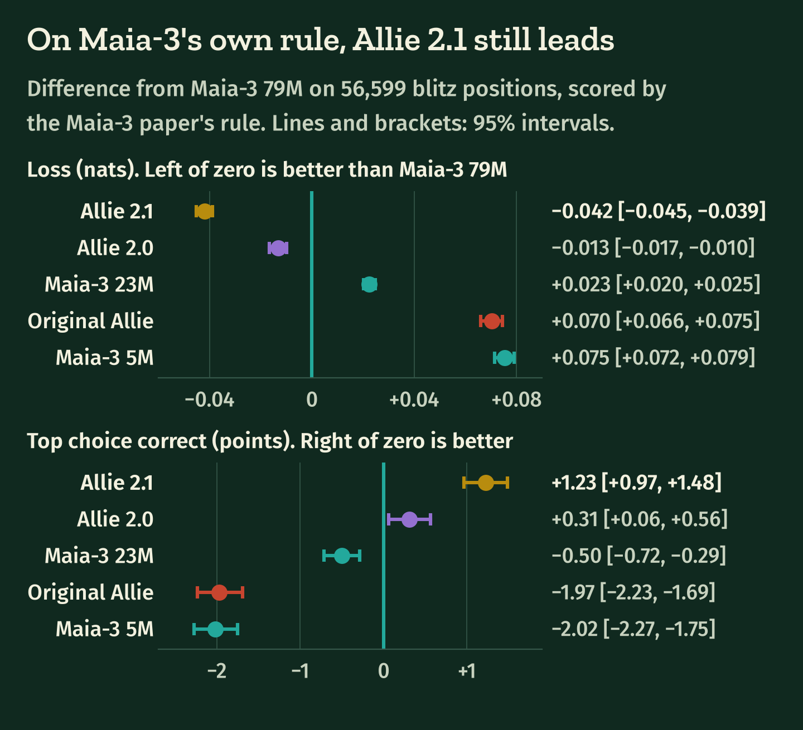
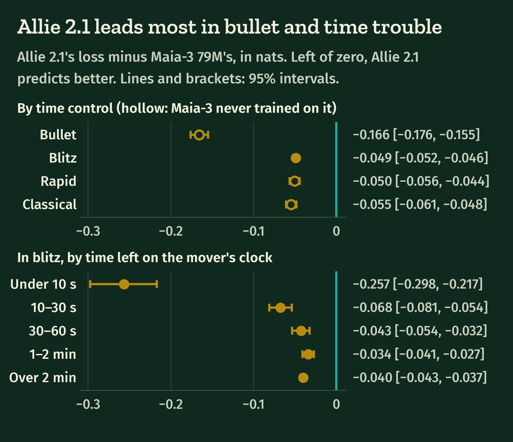

# Allie

> **Disclaimer:** I did not "do" any of this research. The experiments, code, analysis and this write-up were produced by AI agents (Claude Code and OpenAI Codex), with me mostly writing a bunch of prompts. — Yiming

## What Allie is

Allie is a chess model that plays like a human. It predicts the move a person will make from the game so far, both players' ratings and the clock.

It follows our paper [Human-Aligned Chess With a Bit of Search](https://arxiv.org/abs/2410.03893), published at ICLR 2025. That model, the [original Allie](https://github.com/ippolito-cmu/allie), learned from blitz games only.

Allie 2.1 aims to cover every time control, from bullet to classical, and every level of play, experts included. So we judge it by how well it predicts the moves people actually played.

We measure this as a loss: how surprised the model is by each real move, in nats. Lower is better. We also report how often the model's top choice is the move that was played. No model comes near zero loss and the gaps that matter are hundredths of a nat, so the loss plots cut their axes. A gap of 0.03 nats means the played move gets about 1.03 times the probability, as a geometric mean.

**Allie 2.1** is a transformer with 9.2B parameters, of which only 1.2B are used for each move. It trained on 112B tokens of online and over-the-board games and finished on October 28, 2026. The Lichess bot has played it since October 30, 2026.

Our main test set covers every time control and rating level. Its games come from July 2026, a month held out from training.

- Its loss on our main test set is **1.2240**, against 1.2505 for Allie 2.0 and 1.3526 for the original Allie.
- In blitz, its top choice is the move played **60.1%** of the time. For players rated 2400 and above, it is **64.5%**.
- It runs on a CPU: about 14 ms per move on 12 server cores ([fast inference](#fast-inference)).

**Allie 2.0**, the previous release, is smaller: 5.6B parameters, 0.69B for each move. Its main training run, the big run, covered 75B tokens, and a short second anneal then trained it on 1B tokens of 2024-2026 games. [The two compared](#allie-21-against-allie-20).

You can [play Allie 2.1 on Lichess](#play-against-allie-on-lichess) or [download it](#download-and-run-the-model).


*21 of Allie 2.1's 24 blocks route each move to 16 of 256 small "experts", plus one shared expert. The first three are dense. Schematic: which 16 light up changes with the move.*

The model reads the game as a sequence of moves, with both ratings and the time control at the start. At each move it also sees the clocks and the board.

Besides the next move, it predicts how long the player will think and how the game will end.

## Explainer videos

Three silent, captioned animations, five to seven minutes each. Each teaser links to its full 1080p MP4, which GitHub offers as a download.

| [](docs/explainers/how-allie-works/how-allie-works.mp4) | [](docs/explainers/scaling-law/scaling-law.mp4) | [](docs/explainers/how-allie-searches/how-allie-searches.mp4) |
|:---:|:---:|:---:|
| **[How Allie Works](docs/explainers/how-allie-works/how-allie-works.mp4)** (7:23): one real game, from its tokens through attention and 16 of 256 experts to three predictions, and what the experts turned out to do | **[How Good Will It Be?](docs/explainers/scaling-law/scaling-law.mp4)** (5:06): Allie's scaling law, the forecast that missed Allie 2.0's big run, and what changed for Allie 2.1 | **[How Allie Searches](docs/explainers/how-allie-searches/how-allie-searches.mp4)** (6:00): why predicting a strong player isn't playing like one, and how search closes most of the gap |

## Allie 2.1 against Allie 2.0

Allie 2.1 is Allie 2.0's design, wider and trained longer: 9.2B parameters, of which 1.2B are used for each move, trained on 112B tokens of the same data. It took 14.9 days on the same kind of 8-GPU machine. Its weights are on [Hugging Face](https://huggingface.co/yimingzhang/allie-2.1).

| | Allie 2.0 | Allie 2.1 |
|---|---:|---:|
| Main test set (July 2026), loss | 1.2505 | **1.2240** |
| Main test set, players rated 2400 and above | 1.1001 | **1.0603** |
| The same test on September 2026 games | 1.2535 | **1.2265** |
| Blitz benchmark, loss | 1.2030 | **1.1779** |
| Blitz benchmark, top choice correct | 59.29% | **60.12%** |
| Parameters used per move / total | 0.69B / 5.6B | 1.23B / 9.19B |
| Compute per move | 1.39 GFLOPs | 2.45 GFLOPs |
| Time per move, int8 on an AMD EPYC 7763, 12 threads | 10.4 ms | 14.3 ms |
| Calibrated play: search time per move, median / 90th percentile (four games at a human pace, same CPU) | 3.1 / 12.3 s | 1.8 / 4.9 s |
| Calibrated play: largest search | 4,096 leaves | 1,024 leaves |
| Memory, int8 | 6.4 GB | 9.8 GB |


*Positive means Allie 2.1's loss is lower. On September games every cell's 95% interval, bootstrapped over the test's rows, excludes zero (smallest lower bound 0.013). July's per-row scores weren't saved, so its values carry no interval.*

- **Lower loss in every cell.** All 16 time-control and rating cells of the main test set improve, by 0.013 to 0.050. The gain grows with rating: 0.016 for players under 1400, 0.021 at 1400-2000, 0.030 at 2000-2400 and 0.040 at 2400 and above. By time control, it grows from 0.020 in bullet to 0.034 in classical.
- **Against Maia-3 79M.** On the blitz benchmark, Allie 2.1's loss is 0.0489 [0.0458, 0.0522] lower and its top choice is right 1.32 points [1.11, 1.53] more often. On Maia-3's own protocol, the gaps are 0.0419 [0.0388, 0.0451] and 1.23 points [0.97, 1.48]. Allie 2.0's are 0.0238 and 0.48 points, and 0.0132 and 0.31 points.
- **What changed.** Width 2048 instead of 1536. Blocks 1-3 are dense instead of block 1 only. The router computes its gates in log space, with no division. Only the first four expert blocks centre the router's input, not all of them. Attention is exclusive self-attention (XSA). The learning rates are 0.35 times Allie 2.0's base rates, and Adam steps on every other step instead of every step at half the rate.
- **The released weights** are half the final weights and half an exponential moving average of the weights over the end of training. That scores 1.2240, against 1.2248 for the final weights alone. There is no second anneal.
- **The forecast.** A scaling law refit on a new sweep with Allie 2.1's recipe forecast 1.2325 to 1.2396 on the September games. Allie 2.1 scored 1.2265, below the forecast like Allie 2.0, but by less. The forecast assumed the law's best learning rate, 0.21 times Allie 2.0's; Allie 2.1 ran 0.35 times, which the law prices at +0.005, so 1.2370 to 1.2441 as trained.
- **Speed.** Each move reads 1.7 times as many bytes as with Allie 2.0 and takes 1.4 times as long on the same CPU. In calibrated play each searches at its own budget: an Allie 2.1 leaf (a position the search evaluates) costs 1.6-1.8 times an Allie 2.0 leaf, and its search stops at 1,024 leaves instead of 4,096. Within its human-like think time, Allie 2.1 searches 1.8 s a move against 3.1 s (median, four games at a human pace), 4.8 s against 11.8 s in classical.
- **Calibrated play.** The bot's calibration is refitted for Allie 2.1, one rule per time control. Of 80 strength tests (accuracy and blunder rate by time control and rating), 5 fall outside the noise on held-out July games and 11 on September games, against Allie 2.0's 2 and 8; about 4 would by chance. These aren't like for like: Allie 2.1 uses four rules (20 parameters, the best of 8 variants on those July games) to Allie 2.0's one (4), and with one rule of Allie 2.0's form misses 14-16 on July against 2-3. In Elo, the typical miss on September games is larger than Allie 2.0's in bullet (157 against 10), blitz (95 against 58) and rapid (49 against 0), and about the same in classical (19 against 21). In every time control, calibrated play predicts human moves at least as well as Allie 2.1 alone.

More numbers are in [DETAILS](docs/DETAILS.md#allie-21).

## How we built it

### Scaling laws

Before training Allie 2.0, we trained 45 smaller models of two kinds: standard "dense" transformers and mixtures of experts. At each of three compute budgets, we varied the model size to find the best one.

![Loss against active parameters at three training budgets. At each budget the mixture-of-experts curve sits below the dense curve, and the best size grows with compute. A dense model needs 2.2 times [2.0, 2.3], 2.3 times [2.1, 2.6] and 2.5 times [2.0, 3.3] the compute to match.](docs/explainers/figures/sweep.png)

*Dense in gray, mixture of experts in brass. Points are the sizes each curve is fit to; each budget's other sizes aren't drawn. The multiples come from the two fitted scaling laws, with 90% intervals.*

At each budget's best size, the mixture of experts won. A dense model needs about 2.2 to 2.5 times the compute to match it. That is counted FLOPs, not time: on the same GPU, mixture-of-experts runs here took about 1.4 to 1.5 times as long per FLOP (up to 3.7 in three resumed runs, whose earlier GPUs we can't verify), so the gain in hours is smaller.

We then fit a scaling law in the style of [Chinchilla](https://arxiv.org/abs/2203.15556). It predicts the loss from the model's size and the number of training tokens.

The law forecast 1.2856 for the big run. The big run scored 1.2533, below the law's limit for unlimited compute. The second anneal took the released model to 1.2505.


*The big run used about 50 times the compute of the largest sweep budget, and Allie 2.1 2.6 times the big run's. Allie 2.1 also changed the recipe, so its gap isn't only the law's miss. Compute is counted FLOPs, not time. Intervals are 90%.*

We don't fully know why. At small scale the big run's recipe as a whole is slightly worse than the sweep's, but that doesn't show its effect at 51 times the compute: its longer learning-rate decay may account for about 0.012 of the 0.032. The law may also underestimate how far loss keeps falling with compute. Allie 2.1 landed below a law refit with its own recipe too, by less ([Allie 2.1 against Allie 2.0](#allie-21-against-allie-20)).

The law would have picked a bigger model trained on fewer tokens: 1.8B active parameters on 28B tokens. Instead the big run was the largest model that fit on one 8-GPU machine at the time, with 0.69B active parameters on 75B tokens. Allie 2.1 has 1.23B on 112B.

### What else shaped it

We tested most choices on small models, one change at a time. The numbers are in [DETAILS](docs/DETAILS.md#design-findings).

- **Ratings matter most.** Hiding the players' ratings raised the loss by 0.067. For players rated 2400 and above, it rose by 0.111.
- **The clock helps when time is short.** Without the clock, the loss rose by 0.007 overall and by 0.022 late in blitz games.
- **Many small experts work best.** 256 small experts beat 128 larger ones. A shared expert that sees every move also helped.
- **A failed first run.** Our first full run broke down early: its router sent every move to the same few experts. Two small changes to how the router trains fixed it.
- **Borrowed defaults.** The model code comes from [modded-nanoGPT](https://github.com/KellerJordan/modded-nanogpt), which is tuned for short runs. Two of its defaults hurt here, and we changed them.
- **Recent games.** Giving recent months more weight did not help small models. A short final pass over 2024-2026 games did help the big run: it lowered the main-test loss by 0.0028.

### Data

- **Online games.** Every Lichess month with clock times, from May 2017 to August 2026: 7.9B games.
- **Other games.** Over-the-board games from tournaments and broadcasts, plus a small share of engine games.
- **Held out.** No game from July 2026 is used in training. Both test sets come from that month.
- **More strong players.** Strong players are rare, so the sampler favors them. A game's weight doubles for every 200 rating points of its stronger player.
- **No over-use.** No game is used more than 8 times. Allowing 16 made the model memorize.

Favoring strong players lowered the loss for players rated 2400 and above by 0.017 to 0.024. It raised the loss for players under 1400 by 0.012 to 0.043.

### Training



*Each run's learning rate decays to its own end: Allie 2.0's at 75B tokens, Allie 2.1's at 112B. Allie 2.1's point is the released blend; its final weights alone score 1.2248.*

- **Hardware.** One machine with 8 NVIDIA L40S GPUs, for 14.9 days.
- **Length.** 112B tokens in 213,623 steps.
- **The released weights.** Half the final weights and half a moving average of the weights over the end of training. That scores 1.2240, against 1.2248 for the final weights alone.
- **Allie 2.0.** Its big run took 6.6 days and 143,051 steps, and its second anneal 2 hours. Allie 2.1 had none. See [DETAILS](docs/DETAILS.md#training).

## Comparison

We compare Allie 2.1 and 2.0 with the original Allie and [Maia-3](https://arxiv.org/abs/2605.19091) ([weights](https://huggingface.co/collections/MaiaChess/maia3)).

Maia-3 trains only on Lichess blitz, so we compare on blitz. We use 80,000 blitz positions from July 2026, 20,000 from each of four rating bands.


*Scores are on the 20,000 positions search ran on, 5,000 per rating band, so they differ slightly from the 80,000-position numbers below. More search is in [DETAILS](docs/DETAILS.md#search). Lines on dots are 95% intervals of each model's gap to Maia-3 79M, paired on the same positions. Compute is counted FLOPs with the game cached, not time.*

On all 80,000 positions, Allie 2.1's loss is 1.1779 against 1.2269 for Maia-3 79M. It uses 2.45 GFLOPs per move against 9.23. Allie 2.0's loss is 1.2030, at 1.39 GFLOPs.

**This plot is not a fair test for Maia-3.**

- **It scores every position.** That includes the first 10 plies, where openings are partly memorized, and moves made with under 30 seconds left. Maia-3's own evaluation leaves both out.
- **Allie reads the clock.** The released Maia-3 does not, which matters most in time trouble.
- **Allie trains on more, and more recent, data.** It sees every time control from 2017 to 2026, including August 2026. Maia-3 trains on Lichess blitz from January 2023 to July 2025.
- **Compute is counted, not timed.** Allie 2.1 also needs about 18 GB for its weights, and Allie 2.0 about 11 GB, against about 0.3 GB for Maia-3 79M.

### On Maia's own protocol



*Each row compares a model with Maia-3 79M on the same positions.*

Maia-3's paper skips each game's first 10 plies and every position from the moment a player first has under 30 seconds. On that protocol, Allie 2.1 is still ahead of Maia-3 79M.

Its loss is 1.1762 against 1.2180, a gap of 0.0419 [0.0388, 0.0451]. Its top choice is right 60.29% of the time against 59.06%, a gap of 1.23 points [0.97, 1.48].

Allie 2.0 is closer: its loss is 1.2048, a gap of 0.0132 [0.0100, 0.0166], and its top choice is right 59.37% of the time, a gap of 0.31 points [0.06, 0.56]. The original Allie scores 1.2883 and 57.09%.

### Beyond blitz

Allie plays beyond blitz: it supports every time control (bullet, blitz, rapid, classical)\*. It also reads the clock, which helps most when time runs short.



*Bullet, rapid and classical use a separate sample of 20,000 positions each.*

\*Maia-3 never trained on bullet, rapid or classical games.

On this sample, Allie 2.1's loss is below Allie 2.0's in every time control, by 0.021 in bullet to 0.032 in classical.

Tables with every number and interval are in [DETAILS](docs/DETAILS.md#blitz-benchmark).

## Reproducing

The code is one Python package, [`allie`](src/allie). Training needs Linux and NVIDIA GPUs with CUDA 12.8.

Set `ALLIE_DATA` to the folder for the game data and test sets. Runs and scores go to `results/` in this checkout.

1. **Install.**
   ```sh
   git clone https://github.com/y0mingzhang/allie && cd allie
   uv sync              # add --extra search for tree search, --extra test for the tests
   ```
2. **Get the data.** Download each Lichess month from Hugging Face and build it:
   ```sh
   python -m allie.data.fetch 2024-01 raw/2024-01
   python -m allie.data.fastbuild build --hf raw/2024-01 --out $ALLIE_DATA/data-v1/2024-01
   python -m allie.data.fastbuild finalize --out $ALLIE_DATA/data-v1/2024-01
   ```
   Over-the-board and engine games go through `python -m allie.data.external`. Allie 2.1's exact data selection is in [configs/allie-2.1.json](configs/allie-2.1.json).
3. **Build the test set.** `python -m allie.eval.build`
4. **Train.** `allie-train configs/allie-2.1.json --nproc 8` needs eight 48 GB GPUs for about two weeks. It stops every two days; the same command resumes it. The released weights are half the final weights and half their tail average: `python -m allie.experiments.tail_ema blend results/pretrain/allie-2.1/last.pt results/pretrain/allie-2.1/tail-ema-0.08.pt 0.5 results/pretrain/allie-2.1-blend`. Allie 2.0's config is [configs/allie-2.0.json](configs/allie-2.0.json), and [configs/allie-2.0/anneal.sbatch](configs/allie-2.0/anneal.sbatch) has its second anneal.
5. **Evaluate.** `allie-eval --checkpoint results/pretrain/allie-2.1-blend/last.pt` scores the main test set. The blitz comparison has its own scripts in `allie.eval.maia3`.
6. **Figures and videos.** `uv run python docs/explainers/figures/make_figures.py` redraws every figure here from its `data.json`; `--collect` rebuilds that from the results. Each video in [docs/explainers](docs/explainers) has its source, its numbers (`data.json`, with where each comes from) and a `render.sh`, which needs [manim](https://www.manim.community), ffmpeg and the cairo and pango libraries.

Commands run inside the environment: prefix them with `uv run`, or activate `.venv`. Search has its own [guide](src/allie/search/README.md). More on the code is in [DETAILS](docs/DETAILS.md#reproducing).

## Play against Allie on Lichess

Allie 2.1 plays on Lichess as [**AllieTheChessBot**](https://lichess.org/@/AllieTheChessBot) (Allie 2.0 did until October 30, 2026). Challenge it from its profile page.

- **Time controls.** Bullet to classical: 1 to 60 minutes, with up to 180 seconds of increment.
- **Games.** Rated or casual, standard chess from the starting position.
- **It plays at your level.** The bot takes on your rating. Then it plays a move a player of that rating would likely make.
- **It plays like a human opponent at your level.**
- **It thinks like a human.** Before each move, it waits about as long as a person would.
- **Availability.** It plays humans only, up to ten games at a time and one game per opponent.

You can run your own bot from a clone of [this repository](https://github.com/y0mingzhang/allie). It needs only a CPU: about 14 ms per move with Allie 2.1 on 12 server cores, and 9.8 GB of memory.

```sh
uv sync --extra bot --extra fast
export LICHESS_TOKEN=lip_...        # a bot account's token with the bot:play scope
allie-bot play --config configs/lichess-bot.toml
```

The [bot's guide](src/allie/lichess/README.md) covers bot accounts, settings and speed. A `strongest` mode plays the most likely move of a strong player.

### Calibrated play

In its `calibrated` mode the bot plays close to the strength of humans of its rating (by default, yours) at the game's time control. Sampling straight from the model plays weaker than such humans, most at high ratings and in classical, so the bot first searches and then samples, at temperature 1, from the model's distribution leaned toward the moves the search rates highly. One rule per time control, with no rating thresholds, covers every rating: the search is never larger than the human-like think time the bot draws for the move (and its clock) allows, and the lean grows with the rating and with how long humans think in the position, never below a floor, since Allie 2.1 alone also plays below humans rated 800-1400, where the rating term vanishes. On September games, in no rating or time control does calibrated play predict human moves measurably worse than the model alone. The [bot's guide](src/allie/lichess/README.md) covers the setting (search runs on the Rust CPU engine and needs the `fast` extra) and [calibration.py](src/allie/lichess/calibration.py) has the rule and its fit. The rule and the bot's timing, resign and draw rules (`behaviour.json`) are fitted for Allie 2.1. To run the bot with Allie 2.0, check out the whole of [commit cad41559](https://github.com/y0mingzhang/allie/tree/cad41559): its code, rule and default model are Allie 2.0's. On this version, Allie 2.0 plays Allie 2.1's rule, with a warning.


*Move accuracy and blunder rate, scored by Stockfish on every legal move, on 197,191 positions from September 2026 games (the rule is fitted on July games). Each cell compares a model's expected play with the humans' own moves at that rating. Color is the gap in points; a dot means it falls outside the noise (95%, paired with the humans, clustered by game). Calibrated play has 11 of 80 tests outside the noise, against about 4 by chance. In points, only bullet 800 stands out (1.02); blitz 800, blitz 2200 and bullet 2000 are about 0.7. In Elo, bullet and blitz at 800 miss furthest ([Allie 2.1 against Allie 2.0](#allie-21-against-allie-20)). Maia-3 is trained on blitz only and isn't meant for other time controls, and it doesn't see the clock. [DETAILS](docs/DETAILS.md#allie-21) has every test's interval.*

## Download and run the model

The weights are on Hugging Face as [`yimingzhang/allie-2.1`](https://huggingface.co/yimingzhang/allie-2.1), an 18 GB download. The previous release, Allie 2.0, is [`yimingzhang/allie-2.0`](https://huggingface.co/yimingzhang/allie-2.0) (11 GB); the bot plays it from a checkout of [commit cad41559](https://github.com/y0mingzhang/allie/tree/cad41559). The model runs with `transformers` alone, on a CPU or a GPU:

```sh
pip install transformers torch python-chess
```

```python
from transformers import AutoModel

model = AutoModel.from_pretrained("yimingzhang/allie-2.1", trust_remote_code=True)
model.predict("1. e4 e5 2. Nf3", white_elo=1800, black_elo=1750, time_control="180+2")
model.play("1. e4 e5 2. Nf3", elo=1200)  # a move, sampled as a 1200 player would play it
```

`predict` gives every legal move's probability; `analyze` adds the win, draw and loss chances and the expected think time. On a CPU the weights load in int8, on a GPU in BF16. This package has the same code, a command line (`allie-predict "1. e4 e5 2. Nf3" --elo 1800 --tc 180+2`) and the Lichess bot. See [src/allie/lichess/README.md](src/allie/lichess/README.md).

### Fast inference

Allie 2.1 has 9.2B parameters, yet it plays a move in about 14 ms on a server CPU (AMD EPYC 7763, 12 threads), in 9.8 GB of memory. Playing 16 games at once, a step takes 80 ms: about 200 moves a second. Allie 2.0 takes 10.4 ms on the same CPU, in 6.4 GB.

- **It reads little.** Each move reads only the 1.2B parameters it routes through.
- **It reads fast.** Rust kernels (Linux on x86-64; elsewhere the PyTorch reference, 2.5 to 6.5 times slower) stream the int8 weights at up to 75-82% of the memory bandwidth the machine can reach, measured on Allie 2.0.
- **Elsewhere.** On a GPU a move takes about 10 ms (CUDA graphs). A laptop has less memory bandwidth: we estimate 20-35 ms a move, untested.

Every measurement is in [DETAILS](docs/DETAILS.md#fast-inference).

---

The project is MIT-licensed: see [LICENSE](LICENSE) and the upstream notices in [LICENSES.md](LICENSES.md). More detail is in [docs/DETAILS.md](docs/DETAILS.md).
